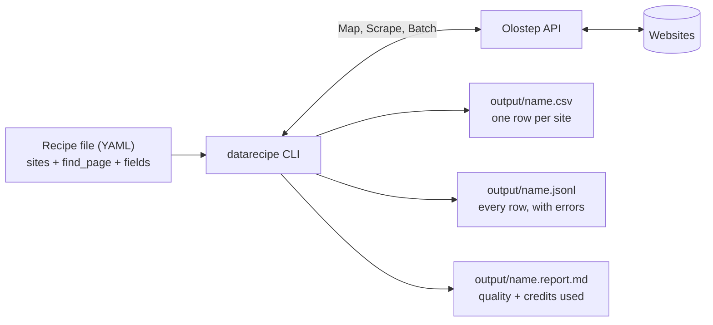
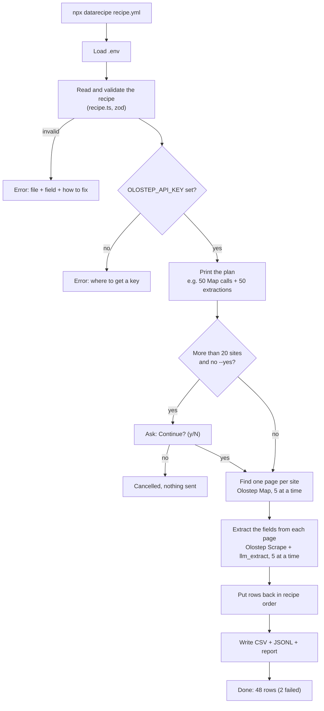
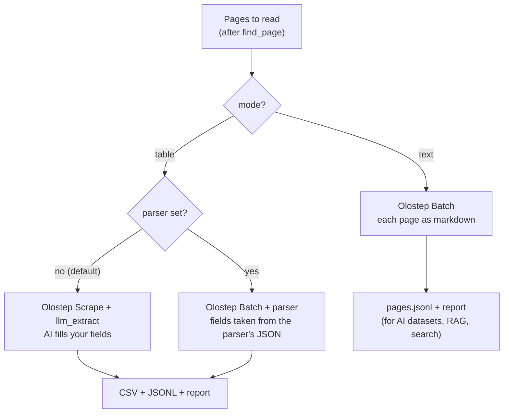
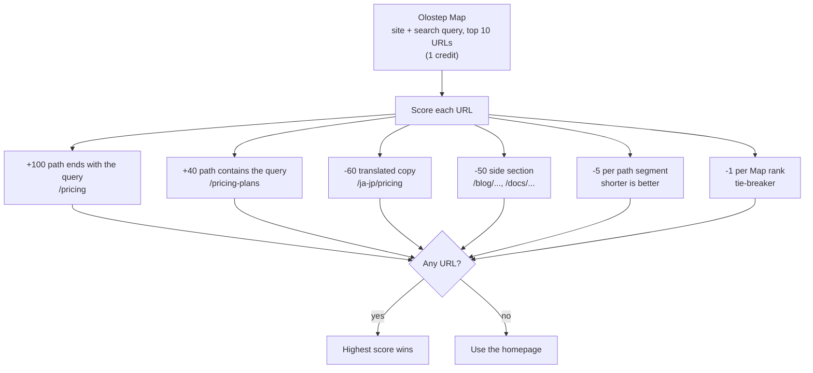
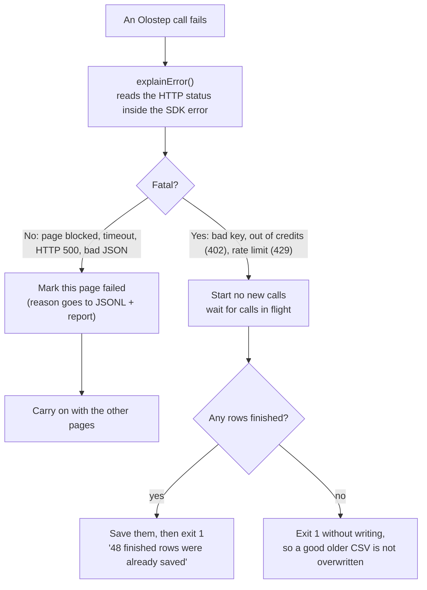
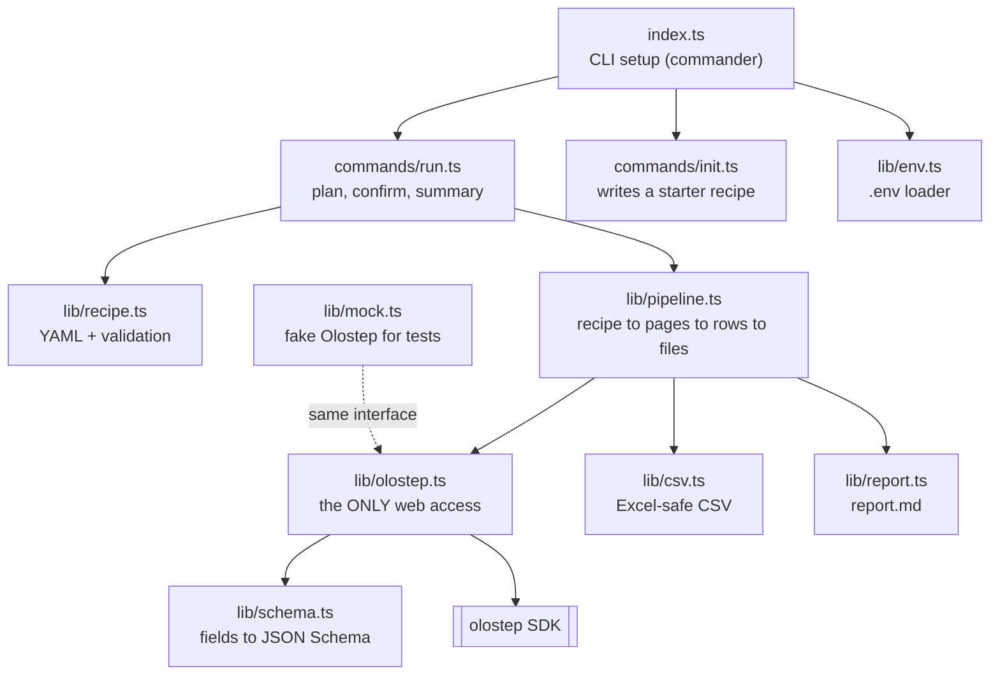
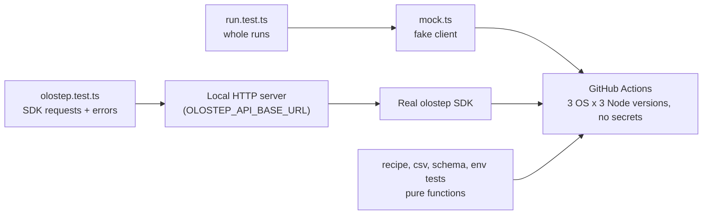

# How datarecipe works

Six diagrams, from the big picture down to the details. GitHub renders them
directly; in VS Code, use a Markdown preview with Mermaid support.

1. [The big picture](#1-the-big-picture)
2. [What happens when you run a recipe](#2-what-happens-when-you-run-a-recipe)
3. [Three ways to read pages](#3-three-ways-to-read-pages)
4. [How the right page is picked](#4-how-the-right-page-is-picked)
5. [What happens when something fails](#5-what-happens-when-something-fails)
6. [Where the code lives](#6-where-the-code-lives)

## 1. The big picture

You write a recipe: which sites, which page, which columns. datarecipe turns it
into Olostep calls and writes the results to files.

All web access and all AI go through Olostep, using the official `olostep` SDK.
datarecipe itself never fetches a page or calls an AI model directly.

## 2. What happens when you run a recipe

`npx datarecipe recipes/x.yml`, step by step (table mode):

The plan and the question come **before** any Olostep call, so a big run never
spends credits by surprise.

## 3. Three ways to read pages

The recipe's `mode` and `parser` keys pick the Olostep feature that reads the pages.

| | Best for | Credits per site |
|---|---|---|
| Scrape + llm_extract | Tens to hundreds of sites, any fields | about 10 (+1 for Map) |
| Batch + parser | Known page types, e.g. emails | 1 to 5 (+1 for Map) |
| Batch (text) | Thousands of pages | 1 (+1 for Map) |

Batches hold at most 100 pages each, so bigger lists are split into several
batches that run in parallel.

## 4. How the right page is picked

`find_page: pricing` should give `example.com/pricing`, not a blog post about
pricing or the Japanese copy of the page. Olostep Map ranks the URLs, and
`pickBestPage` in `olostep.ts` chooses among the top 10:

## 5. What happens when something fails

One bad page never stops a run. Only errors that would make **every** next call
fail stop it, and the rows that finished are kept.

Every error the user sees reads `Error: what happened + how to fix it`. Stack
traces are shown only with `DEBUG=datarecipe`.

## 6. Where the code lives

| Rule | Why |
|---|---|
| Only `olostep.ts` talks to the web | One place to change, one place to test |
| Progress goes to stderr, data to files | Output can be piped; CI logs show what users see |
| Tests run offline | `mock.ts` replaces the SDK; `olostep.test.ts` runs the real SDK against a local fake server. CI never needs a real key |
| Runtime dependencies: commander, zod, yaml, olostep | Small install, small attack surface |

### How the tests cover it

New here? Start with [CONTRIBUTING.md](../CONTRIBUTING.md), then pick an issue from
[ISSUES.md](../ISSUES.md).
